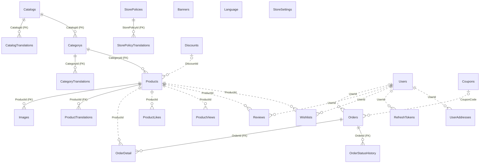
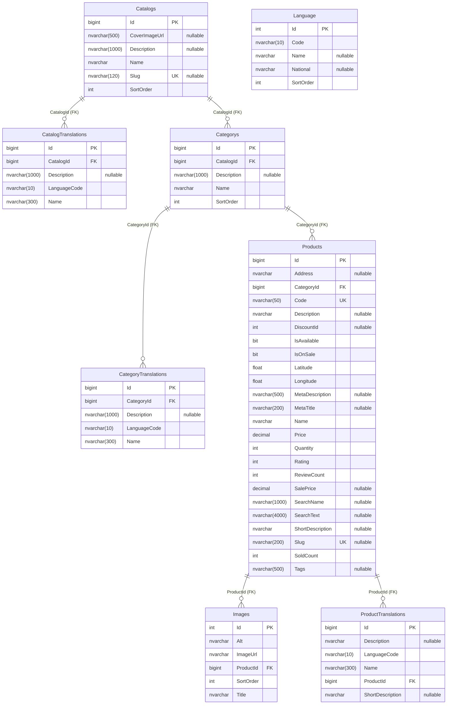
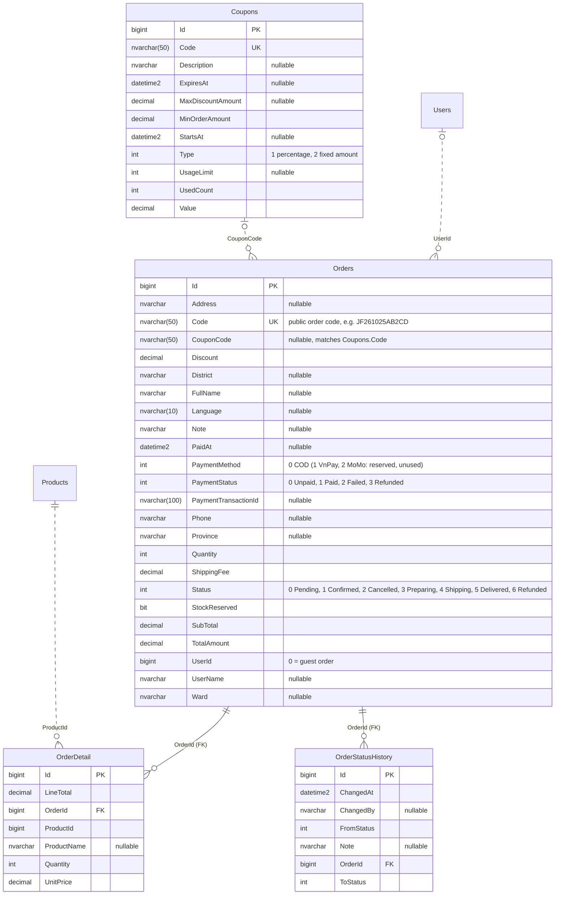
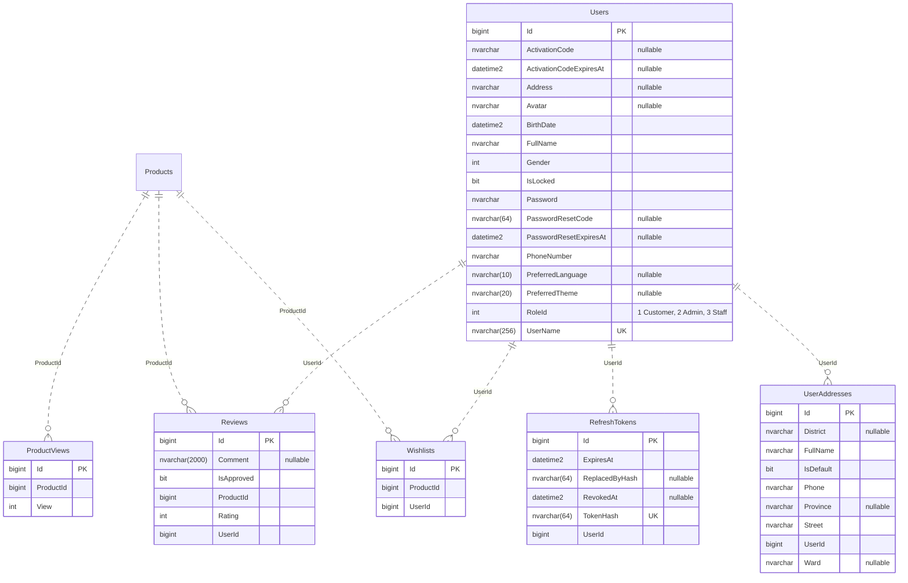
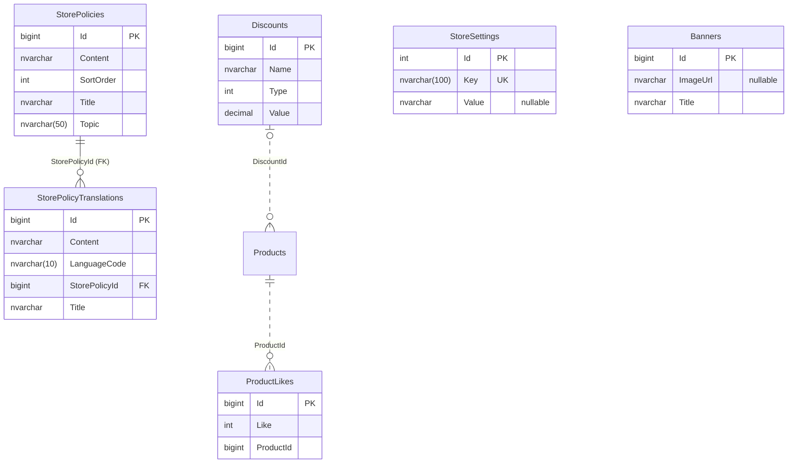

# Entity–relationship diagrams (ERD)

The `vqt_japanese_food` database (SQL Server) has **24 tables**. The diagrams below are generated from the EF Core model
(`JapaneseFood.Entity/Migrations/DataContextModelSnapshot.cs`), so they match the database after the latest migration.

PNG exports of every diagram are in [`docs/diagrams/`](diagrams/) (for reports and slides).

## How to read the diagrams

| Notation | Meaning |
|---|---|
| Solid line `||--o{` | A real foreign key in the database (**FK**), enforced by a constraint. There are 9 of these. |
| Dotted line `..` | A **logical** reference: the column holds another table's id or code, but the database has no FK constraint; the application enforces it. There are 12 of these. |
| `||` / `|o` on the left end | Required / optional (for example guest orders have `UserId = 0`) |
| `o{` on the right end | Zero or more |
| `PK`, `FK`, `UK` | Primary key, foreign key, unique value (unique index) |

To keep the diagrams readable, the audit columns that most tables inherit from `BaseEntities` are **not drawn**:
`CreatedAt`, `CreatedBy`, `UpdatedAt`, `UpdatedBy`, `IsActive` (in use) and `IsDelete` (soft delete).

## Overview

## 1. Menu (sections, categories, dishes, translations)

The menu has two levels: a **section** (`Catalogs`, for example "Sushi & Sashimi") contains **categories** (`Categorys`, for example "Nigiri"), and a category contains **dishes** (`Products`).
Each level has a `*Translations` table for English, Japanese, Korean and French; the base columns hold the Vietnamese text, which is also the fallback when a translation is missing.
`SearchName`/`SearchText` are the accent-free search index, combining names, descriptions, tags and category names in every language.

## 2. Orders and coupons

`OrderDetail` **snapshots** the dish name and unit price at the time of purchase (`ProductName`, `UnitPrice`, `LineTotal`), so later price changes never alter past orders.
Every status change is recorded in `OrderStatusHistory` (who, when, note).
`StockReserved` tells whether the order is holding stock; cancelling the order returns the stock and the coupon use.

## 3. Customers and accounts

`Users.UserName` is the sign-in email. Passwords are hashed (ASP.NET Core `PasswordHasher`); `RefreshTokens` only stores a **hash** of each token,
and `ReplacedByHash` is used to detect a token being reused.

## 4. Store content and legacy tables

`StoreSettings` is a key–value table: store details, delivery fee, free-delivery threshold, website address, and the "Our story" page content (JSON per language).

## Multi-column unique constraints

| Table | Columns | Meaning |
|---|---|---|
| `CatalogTranslations` | `CatalogId`, `LanguageCode` | At most one translation per section per language |
| `CategoryTranslations` | `CategoryId`, `LanguageCode` | At most one translation per category per language |
| `ProductTranslations` | `ProductId`, `LanguageCode` | At most one translation per dish per language |
| `Reviews` | `ProductId`, `UserId` | A customer can review a dish only once |
| `Wishlists` | `UserId`, `ProductId` | A dish appears in a customer's favourites only once |
| `StorePolicyTranslations` | `StorePolicyId`, `LanguageCode` | At most one translation per policy entry per language |

## Table list

| Table | Purpose | Status |
|---|---|---|
| `Catalogs`, `CatalogTranslations` | Menu sections and their translations | In use |
| `Categorys`, `CategoryTranslations` | Categories and their translations (the `Categorys` name is kept from the old system) | In use |
| `Products`, `ProductTranslations` | Dishes: price, stock, SEO, search index, and their translations | In use |
| `Images` | Dish photos; the photo with the lowest `SortOrder` is the cover | In use |
| `Language` | The 5 supported languages, created automatically at startup | In use |
| `Orders`, `OrderDetail` | Orders and their dish lines | In use |
| `OrderStatusHistory` | Status history of each order | In use |
| `Coupons` | Discount codes (percentage or fixed amount, usage limit, validity period) | In use |
| `Users` | Customer, staff and administrator accounts (told apart by `RoleId`) | In use |
| `UserAddresses` | Address book, up to 10 addresses per customer | In use |
| `RefreshTokens` | Sign-in sessions (hashed refresh tokens) | In use |
| `Wishlists` | Favourite dishes | In use |
| `Reviews` | Reviews by customers who bought the dish | In use |
| `ProductViews` | Dish view counter, used for ranking when there is not enough sales data | In use |
| `StorePolicies`, `StorePolicyTranslations` | Policies & FAQ entries and their translations | In use |
| `StoreSettings` | Store settings as key–value pairs | In use |
| `Discounts` | Discount campaigns of the legacy MVC site | Legacy site only |
| `Banners` | Banners of the legacy MVC site | No longer used |
| `ProductLikes` | Likes of the legacy MVC site (replaced by `Wishlists`) | No longer used |
