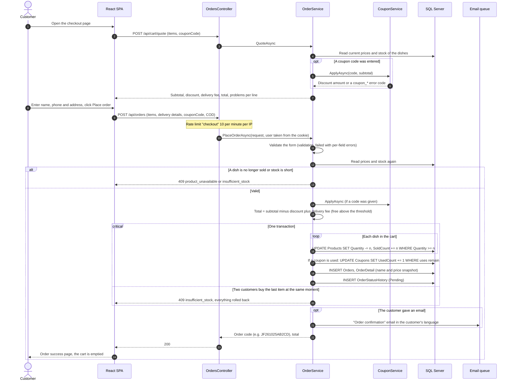
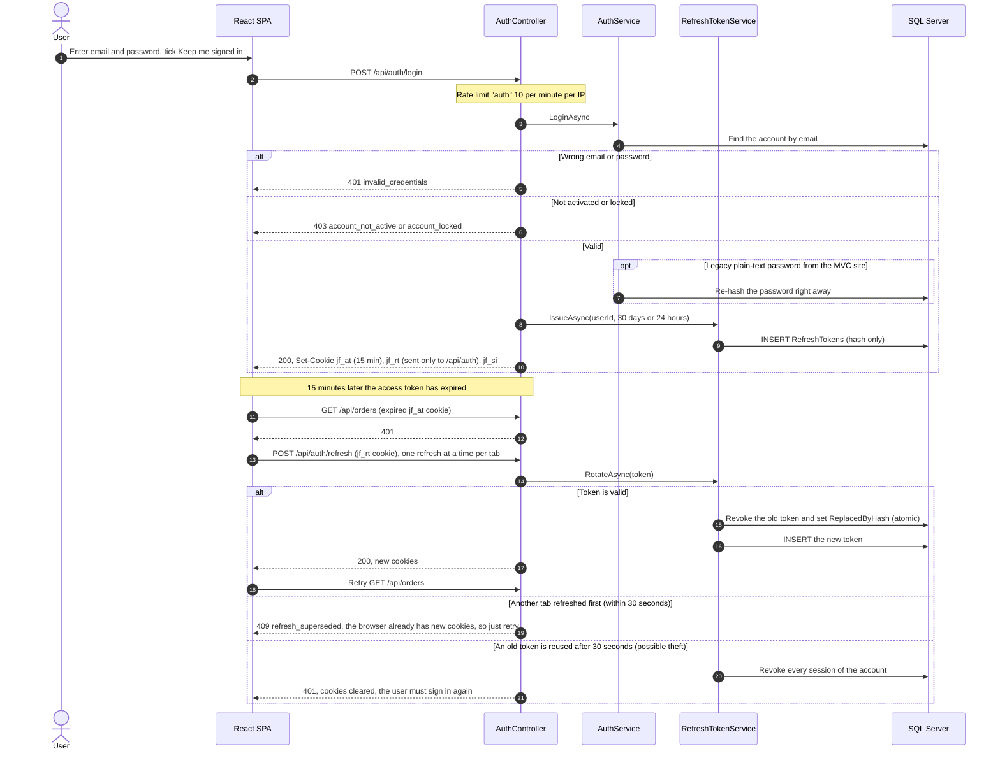
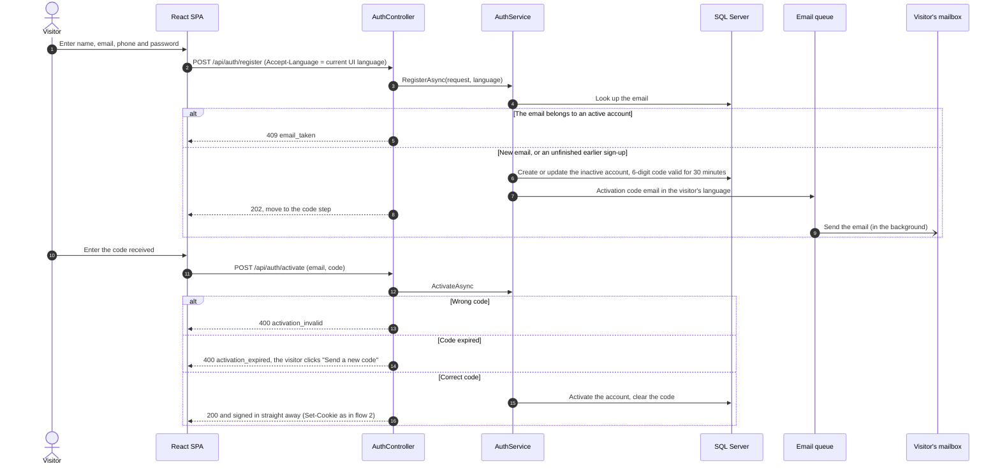
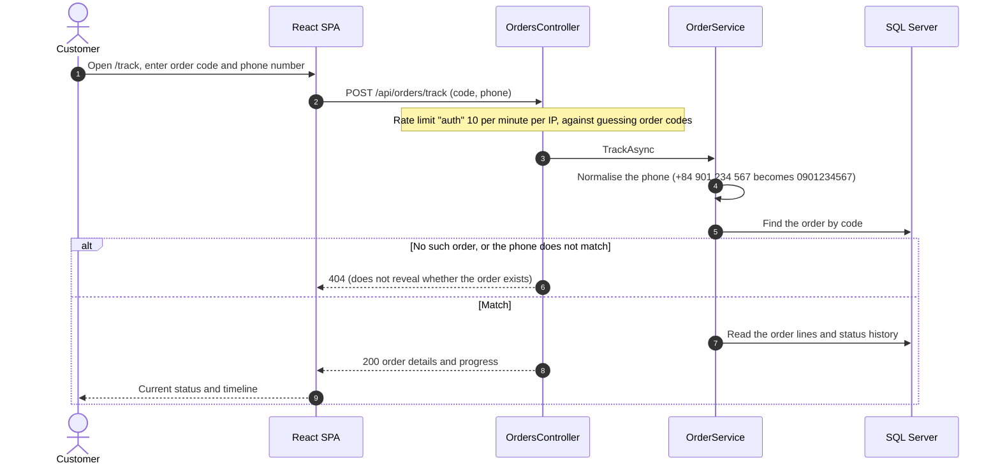
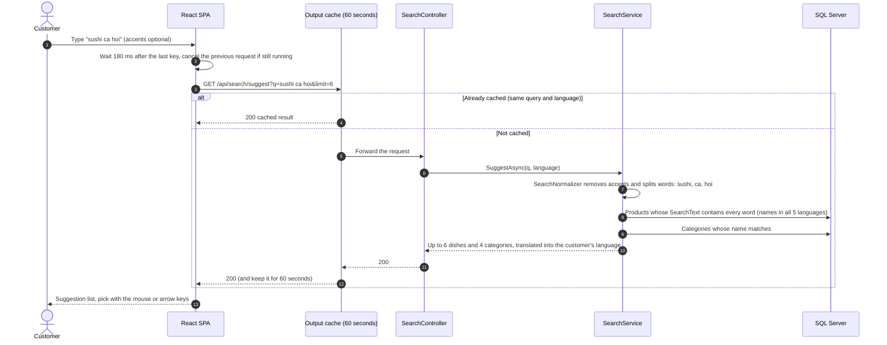
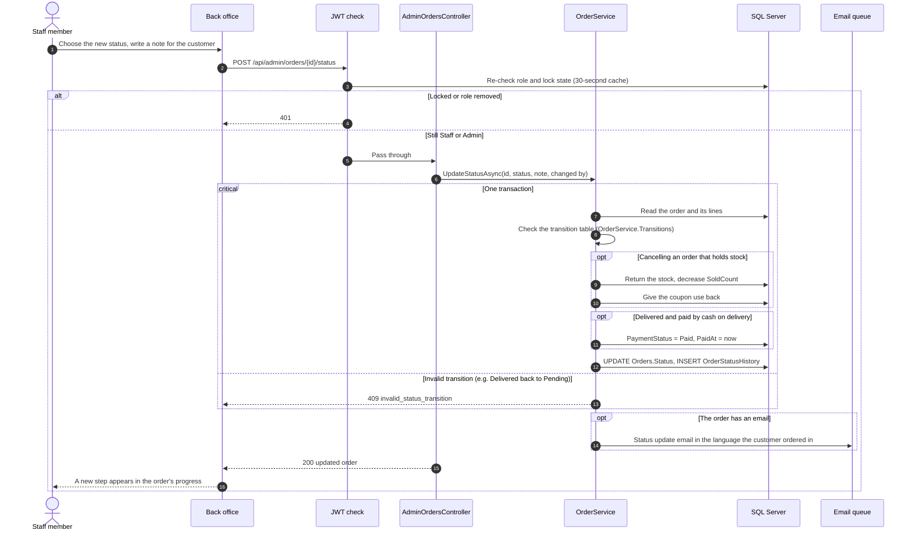
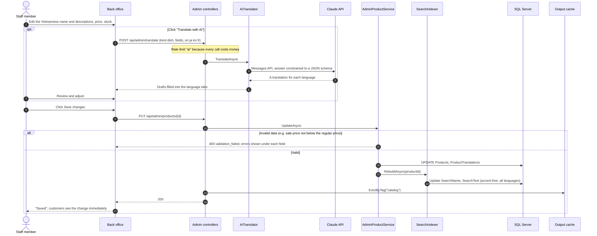

# Sequence diagrams

The main flows of the system, drawn from the current code. Participant names are the real class and endpoint names so you can find them in the code.
PNG exports of every diagram are in [`docs/diagrams/`](diagrams/).

Common participants:

| Name in the diagrams | What it is |
|---|---|
| React SPA | The storefront and back office (`frontend/`); calls the API with `fetch`, cookies are sent automatically |
| `…Controller` | A controller in `JapaneseFood.Api` (reads identity and language, then calls a service) |
| `…Service` | Business logic in `JapaneseFood.Service` |
| SQL Server | The `vqt_japanese_food` database, accessed through EF Core |
| Email queue | `IEmailQueue` + `EmailBackgroundSender`: emails are sent in the background, requests never wait for SMTP |

## 1. Place an order (cash on delivery)

The browser only sends dish ids and quantities. Prices, discounts, delivery fee and total are always recalculated on the server.

## 2. Sign in and automatic session refresh

The access token lives 15 minutes; the refresh token 30 days ("Keep me signed in") or 24 hours. Both are HttpOnly cookies, so JavaScript cannot read them.

## 3. Sign up and activate the account

## 4. Track an order (guest)

No account needed: just the order code and the phone number used when ordering. The "Track order" button in the email opens this page with both filled in and looks the order up automatically.

## 5. Search as you type

## 6. Staff update an order's status

Valid order: Pending → Confirmed → (Preparing) → Out for delivery → Delivered → (Refunded). An order can only be cancelled before it goes out for delivery.

## 7. Staff edit a dish (with AI translation)

"Translate with AI" is optional: it only appears when the server has `Anthropic:ApiKey`. The translation is only a draft in the form; staff review it before saving.

