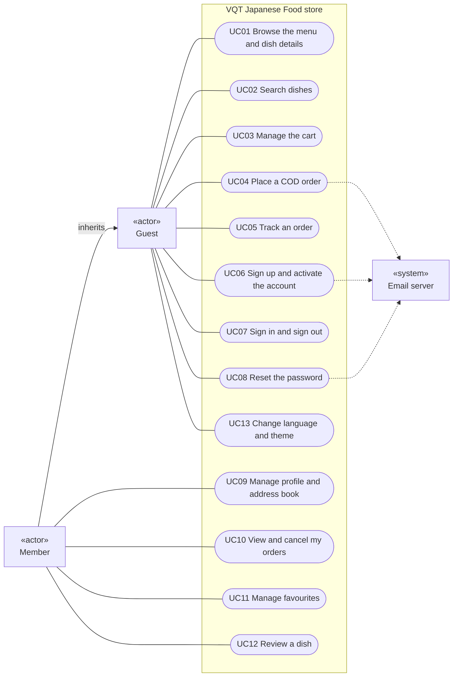
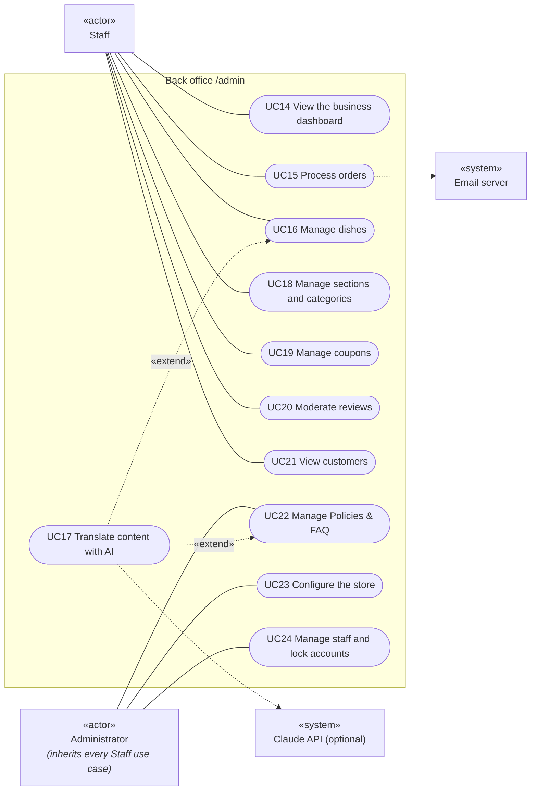

# Use case specifications

The system's functions from the users' point of view, with main flows, exceptions and business rules. Every rule and error code comes from the current code.
Technical flows are in [sequence-diagrams.md](sequence-diagrams.md), the data model in [erd.md](erd.md). PNG exports of the diagrams are in [`docs/diagrams/`](diagrams/).

## Actors

| Actor | Description |
|---|---|
| Guest | A visitor who is not signed in. Browses the menu, places orders, tracks an order with its code and phone number. |
| Member | A customer with an activated account. Can do everything a guest can, plus address book, order history, favourites and reviews. |
| Staff | Uses the back office: processes orders, manages dishes, catalog, coupons and reviews; views customers and policies. |
| Administrator | Can do everything staff can, plus edit policies, store settings, grant or remove access, lock accounts. |
| Email server (SMTP) | External system that delivers order confirmations, status updates, activation codes and password reset codes. |
| Claude API | External system, **optional**: only used by "Translate with AI" when the server has an API key. |

## Use case diagram: store

## Use case diagram: back office

Staff can **read** Policies & FAQ, but only administrators can change them (UC22).

## Use case list

| ID | Name | Actor | Summary |
|---|---|---|---|
| UC01 | Browse the menu and dish details | Guest | Browse by section and category, filter by price, tag or on sale; see photos, price, stock, reviews and frequently-bought-together dishes. |
| UC02 | Search dishes | Guest | Suggestions while typing, accents optional, works in any of the 5 languages (see sequence 5). |
| UC03 | Manage the cart | Guest | Add, change quantity, remove; the cart is kept in the browser; at most 99 of a dish, 50 different dishes, never more than the stock. |
| UC04 | Place a COD order | Guest | Order without an account, apply a coupon, pay cash on delivery. |
| UC05 | Track an order | Guest | Look an order up by its code and phone number. |
| UC06 | Sign up and activate the account | Guest | Sign up with an email, activate with a 6-digit code sent by email. |
| UC07 | Sign in and sign out | Guest | Sign in with email and password; the session refreshes itself. |
| UC08 | Reset the password | Guest | Receive a code by email and set a new password. |
| UC09 | Manage profile and address book | Member | Edit name, phone, date of birth, gender, change password; save up to 10 addresses and pick a default. |
| UC10 | View and cancel my orders | Member | Order history and details; cancel an order that is still pending. |
| UC11 | Manage favourites | Member | Add or remove dishes from favourites. |
| UC12 | Review a dish | Member | Rate 1–5 stars and comment on a dish bought before. |
| UC13 | Change language and theme | Guest | 5 languages (vi, en, ja, ko, fr) and 4 colour themes; saved in the browser, and in the profile when signed in. |
| UC14 | View the business dashboard | Staff | Revenue, orders, average order value, 30-day chart, best sellers, dishes running low, orders awaiting confirmation. |
| UC15 | Process orders | Staff | Filter orders, view details, change status, print invoices. |
| UC16 | Manage dishes | Staff | Add, edit, hide/show, delete dishes; photos; translations; SEO; bulk actions. |
| UC17 | Translate content with AI | Staff | Draft English, Japanese, Korean and French text from the Vietnamese. Extends UC16, UC18 and UC22. |
| UC18 | Manage sections and categories | Staff | Two-level menu, display order, translations. |
| UC19 | Manage coupons | Staff | Create, edit, switch off and delete coupons. |
| UC20 | Moderate reviews | Staff | Hide, restore and delete reviews (several at once). |
| UC21 | View customers | Staff | Account list, total spent, address book, recent orders. |
| UC22 | Manage Policies & FAQ | Administrator | Add, edit and delete policy entries and their translations. |
| UC23 | Configure the store | Administrator | Contact details, delivery fee, free-delivery threshold, low-stock threshold, website address. |
| UC24 | Manage staff and lock accounts | Administrator | Grant or remove access by email, change roles, lock and unlock accounts. |

## Detailed specifications

### UC04 – Place a COD order

| Item | Content |
|---|---|
| Primary actors | Guest, Member |
| Secondary actor | Email server |
| Description | The customer orders the dishes in the cart for home delivery and pays cash on delivery. |
| Precondition | The cart contains at least one dish that is still sold. |
| Postcondition | The order exists with status "Pending"; stock has been decreased; the coupon's use count has increased; the customer receives a confirmation email (if an email was given). |
| Trigger | The customer clicks "Checkout" in the cart. |

**Main flow**

1. The system shows the checkout page with a summary based on the latest prices and stock from the server.
2. The customer enters full name, phone number, address (street and number; province and ward from the list) and an optional note. A signed-in member can pick an address from the address book.
3. A guest may enter an email to receive the confirmation; a member uses the account email.
4. The customer enters a coupon code (optional); the system recalculates and shows the discount.
5. The customer clicks "Place order".
6. The system validates the data, recalculates every amount on the server, decreases stock and saves the order in one transaction.
7. The system shows the success page with the order code (`JF` + date + 5 characters), empties the cart and sends a confirmation email in the customer's language.

**Exceptions**

- 4a. The coupon cannot be used: the reason is shown (`coupon_invalid`, `coupon_not_started`, `coupon_expired`, `coupon_used_up`, `coupon_min_order`); the customer removes it or tries another code.
- 6a. Invalid data: errors appear under each field (`validation_failed`); back to step 2.
- 6b. A dish is no longer sold or stock is short (including when someone else just bought the last one): `409 product_unavailable` / `insufficient_stock`, nothing is deducted; the customer updates the cart.
- 6c. More than 10 attempts per minute from one IP address: temporarily blocked (429).

**Business rules**

- BR1. The browser only sends dish ids and quantities; the price used is the sale price when the dish is on sale, otherwise the regular price.
- BR2. The phone must be a 10-digit Vietnamese number (`+84` accepted); name up to 100 characters, address up to 250, note up to 500.
- BR3. Total = subtotal − discount + delivery fee. Delivery is free when (subtotal − discount) ≥ the threshold in Settings; a threshold of 0 means never free.
- BR4. Only cash on delivery (COD) is supported; other methods are rejected (`payment_method_unavailable`).
- BR5. The dish name and unit price are copied into the order line and do not change when the dish's price changes later.

### UC05 – Track an order

| Item | Content |
|---|---|
| Primary actor | Guest (signed-in members see their orders in UC10) |
| Precondition | The customer has the order code and the phone number used when ordering. |
| Postcondition | No data changes. |

**Main flow**

1. The customer opens "Track order" (or clicks the button in the email: the order code and phone are pre-filled and the page looks the order up automatically).
2. The customer enters the order code and phone number.
3. The system shows the current status, the dishes, the total and the progress over time.

**Exceptions**

- 3a. Wrong code or the phone does not match: "order not found". The system does not reveal whether the order code exists.

**Business rule**: at most 10 lookups per minute per IP, to prevent guessing order codes.

### UC06 – Sign up and activate the account

| Item | Content |
|---|---|
| Primary actor | Guest |
| Secondary actor | Email server |
| Precondition | The email does not belong to an active account. |
| Postcondition | The account is activated and the customer is signed in. |

**Main flow**

1. The guest enters full name, email, phone number and password.
2. The system creates an inactive account and emails a 6-digit code (valid 30 minutes) in the language the guest is using.
3. The guest enters the code.
4. The system activates the account and signs the guest in.

**Exceptions**

- 2a. The email belongs to an active account: `email_taken`.
- 2b. The email signed up before but never activated: the system lets the person sign up again (updating the details and sending a new code) instead of locking the email out.
- 4a. Wrong code: `activation_invalid`. Expired code: `activation_expired`; the guest clicks "Send a new code".

**Business rule**: passwords are 8–128 characters with at least one letter and one digit; they are hashed and never stored in plain text.

### UC07 – Sign in and sign out

| Item | Content |
|---|---|
| Primary actors | Member, Staff, Administrator |
| Precondition | The account is activated and not locked. |
| Postcondition | A session exists (HttpOnly cookies). |

**Main flow**

1. The user enters email and password and optionally ticks "Keep me signed in".
2. The system authenticates and creates a session: access token for 15 minutes, refresh token for 30 days (with "Keep me signed in") or 24 hours.
3. When the access token expires, the browser refreshes the session without asking the user to sign in again.
4. On "Sign out", the refresh token is revoked and the cookies are cleared.

**Exceptions**

- 2a. Wrong email or password: `invalid_credentials` (without saying which one).
- 2b. Not activated: `account_not_active`. Locked: `account_locked`.
- 3a. An old refresh token is reused (a sign of theft): the system revokes every session of the account and the user must sign in again.

**Business rules**: at most 10 attempts per minute per IP; old accounts from the MVC site with plain-text passwords are accepted once and re-hashed immediately.

### UC08 – Reset the password

**Main flow**: the customer enters their email → the system emails a 6-digit code (valid 30 minutes) → the customer enters the code and a new password → the system changes the password and **signs out every device**.

**Exceptions**: an unknown email gets the same "sent" message (no way to learn which emails have accounts); a wrong or expired code: `reset_code_invalid`.

### UC10 – View and cancel my orders

| Item | Content |
|---|---|
| Primary actor | Member |
| Precondition | Signed in. |
| Postcondition (when cancelling) | The order becomes "Cancelled", stock is returned, the coupon use is given back, the customer receives an email. |

**Main flow**: the member opens "My orders" → sees the list (newest first) → opens an order → clicks "Cancel order" and confirms.

**Exceptions**: the order is no longer "Pending": `order_not_cancellable`; the order does not belong to this account: `order_not_found`.

### UC12 – Review a dish

| Item | Content |
|---|---|
| Primary actor | Member |
| Precondition | The member has at least one order (not cancelled) containing the dish and has not reviewed it yet. |
| Postcondition | The review is shown straight away; the dish's average rating and review count are recalculated. |

**Main flow**: the member opens the dish page → picks a rating (1–5) and writes an optional comment (up to 2000 characters) → submits.

**Exceptions**: has not bought the dish: `review_requires_purchase`; already reviewed: `review_exists`.

**Business rules**: the reviewer's name is partly masked in public; reviews carry a "verified purchase" label; staff can hide or delete them (UC20).

### UC15 – Process orders

| Item | Content |
|---|---|
| Primary actors | Staff, Administrator |
| Secondary actor | Email server |
| Precondition | Signed in with the Staff or Admin role. |
| Postcondition | The order status changes, a new step is added to its progress, the customer receives an email. |

**Main flow**

1. Staff open "Orders" and filter by status or date, or search by order code, name or phone number.
2. Open an order: customer details, dishes, amounts, progress.
3. Choose a valid next status, write an optional note for the customer, confirm.
4. The system updates the order and emails the customer in the language they ordered in.
5. (Optional) Click "Print invoice".

**Exceptions**: invalid status change: `invalid_status_transition`; a staff member who was just locked or lost their role is refused (401) within at most 30 seconds.

**Business rules**

| From | Can move to |
|---|---|
| Pending | Confirmed, Cancelled |
| Confirmed | Preparing, Out for delivery, Cancelled |
| Preparing | Out for delivery, Cancelled |
| Out for delivery | Delivered |
| Delivered | Refunded |
| Cancelled, Refunded | (final) |

- Cancelling returns the stock, decreases the sold count and gives the coupon use back.
- A COD order moving to "Delivered" is marked as paid automatically.
- The system always asks for confirmation before cancelling or refunding.

### UC16 – Manage dishes

| Item | Content |
|---|---|
| Primary actors | Staff, Administrator |
| Secondary actor | Claude API (through UC17, optional) |
| Postcondition | The dish is saved, the search index is updated, and customers see the change immediately (the cache is cleared). |

**Main flow**

1. Staff open "Dishes": filter (Visible, Hidden, On sale, Running low, Out of stock), sort, search.
2. Click "Add dish" or open a dish and enter the Vietnamese name, short description, description, category, price, sale price, stock, tags and SEO fields.
3. Enter translations in the language tabs, or use UC17.
4. Save. Once the dish exists, upload photos (drag and drop), reorder them and choose the cover.
5. (Optional) Select several dishes to hide, show or delete them in bulk.

**Exceptions**: errors appear under each field: empty name or category (`required`), price ≤ 0 (`must_be_positive`), sale price not below the regular price (`must_be_below_price`), negative stock (`must_not_be_negative`), duplicate dish code (`duplicate`). Leaving the page with unsaved changes asks for confirmation.

**Business rules**: photos are JPG, PNG or WebP up to 5 MB; the dish code and URL are generated when left empty; any language without a translation shows the Vietnamese text; with "Taking orders" off, the dish stays visible but cannot be ordered.

### UC19 – Manage coupons

**Main flow**: staff open "Coupons" → "New coupon" → enter the code, discount type (percentage or fixed amount), value, minimum order, maximum discount, usage limit, start and end dates → save. The list shows each coupon's state automatically: Running, Scheduled, Expired, Used up, Off.

**Business rules**

- Codes are 3–30 characters of capital letters, digits, `-` and `_` (`invalid_code`), and must not repeat another code, including deleted ones (`duplicate`).
- A percentage must be between 1 and 100 (`percent_range`); a fixed amount must be > 0.
- The usage limit cannot be lower than the uses so far (`below_used`); the end date must be after the start date (`end_before_start`).
- To pause a coupon, switch off "Enabled" instead of deleting it.

### UC24 – Manage staff and lock accounts

| Item | Content |
|---|---|
| Primary actor | Administrator |
| Precondition | The person being given access already has an account on the website. |
| Postcondition | The role or lock state changes; the person affected is signed out. |

**Main flow**: the administrator opens "Staff" → enters the email, chooses the role (Staff or Administrator) → "Grant access". To take access away: "Remove access (customer)". To lock: open the customer's page → "Lock account".

**Exceptions**: the email has no account: `user_not_found`; locking or changing one's own role: `cannot_change_self`; locking or demoting the last administrator: `last_admin`.

**Business rules**: locking revokes every session; back-office access is re-checked on every request (30-second cache), so a locked or demoted person loses access almost immediately.
